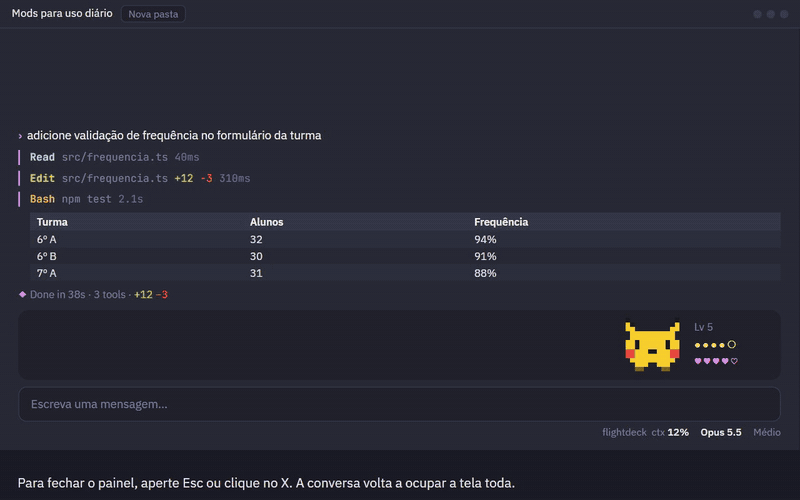

# MODS-CLAUDECODE

Os mods do Claude Code que eu uso no dia a dia, prontos para instalar em qualquer máquina, com um guia em vídeo explicando como usar cada um.

<p align="center">
  <a href="guia/guia.mp4"></a>
</p>

<p align="center">
  <b><a href="guia/guia.mp4">▶ Assistir ao guia completo com narração (MP4, 5 min)</a></b>
  &nbsp;·&nbsp;
  <a href="guia/index.html">versão interativa (HTML)</a>
</p>

Este repositório é um **marketplace do Claude Code**. Ele não copia o código dos mods: aponta para os repositórios originais, então cada mod continua recebendo as atualizações dos autores.

| Mod | O que faz | Onde aparece |
|---|---|---|
| [mod-store](https://github.com/hellosverre/mod-store) | Loja com cerca de 2.700 mods, etiqueta de acesso de cada um e instalação com confirmação | Painel lateral (`/mods`) |
| [flightdeck](https://github.com/scasella/claude-flightdeck) | Contexto usado, custo da sessão, permissões e subagentes | Linha de status e painel lateral (`/flightdeck`) |
| [skins](https://github.com/hellosverre/claude-skins) | Temas para a conversa: cor por ferramenta, cards de diff, tabelas | Conversa e painel lateral (`/skin`) |
| [pokemon](https://github.com/dgokcin/claude-pokemon-mod) | Um Pokémon que reage ao trabalho do Claude, sobe de nível e evolui | Faixa acima da caixa de mensagem |
| [prismantis](https://github.com/NahumLitvin/prismantis) *(opcional)* | Tabelas, código, Mermaid e LaTeX coloridos | Conversa. **Conflita com o skins**: use um dos dois |
| [human-in-the-loop](https://github.com/tzafrir/human-in-the-loop) *(opcional)* | Claude passa para você as tarefas que só você pode fazer | Painel `My tasks` |

## Requisito

Claude Code **2.1.287 ou superior**. Confira com:

```bash
claude --version
```

Se for mais antigo, atualize:

```bash
claude update
```

> No Windows, o app desktop traz o próprio `claude.exe`, às vezes mais novo que o do terminal. O script `instalar.ps1` encontra e usa esse binário sozinho.

## Instalação

### Opção 1: clonar e rodar o script (recomendado)

O script adiciona o marketplace, instala mod-store, flightdeck, skins e pokemon, e aplica meus ajustes (rótulos do flightdeck em português). Se um mod já estiver instalado, ele mantém o existente para não carregar duas cópias.

**Windows (PowerShell):**

```powershell
git clone https://github.com/Victormartinsilva/MODS-CLAUDECODE.git
cd MODS-CLAUDECODE
powershell -ExecutionPolicy Bypass -File .\instalar.ps1
```

**macOS, Linux ou Git Bash:**

```bash
git clone https://github.com/Victormartinsilva/MODS-CLAUDECODE.git
cd MODS-CLAUDECODE
bash instalar.sh
```

### Opção 2: sem clonar, de dentro do Claude Code

```
/plugin marketplace add Victormartinsilva/MODS-CLAUDECODE
/plugin install mod-store@mods-victor
/plugin install flightdeck@mods-victor
/plugin install skins@mods-victor
/plugin install pokemon@mods-victor
```

Para os rótulos do flightdeck em português, rode `/plugin configure flightdeck@mods-victor` e use `ARQUITETO` e `PERMISSÕES`.

### Depois de instalar

Os ajustes do skins e do Pokémon ficam guardados pelos próprios mods, então são feitos com um comando dentro do Claude Code:

```
/reload-plugins
/skin dracula
/skin band off
/pokemon abra
```

| Ajuste | Por quê |
|---|---|
| `/skin dracula` | Tema escolhido |
| `/skin band off` | Remove a faixa de uso (context, 5h, 7d) acima do prompt |
| `/pokemon abra` | Parceiro atual. Troque à vontade |
| flightdeck `ARQUITETO` / `PERMISSÕES` | Únicos rótulos traduzíveis do flightdeck. O resto do texto dele é fixo em inglês |
| prismantis desligado | Ele redesenha as mesmas partes que o skins |

## Guia em vídeo

São dois formatos com o mesmo conteúdo:

- [`guia/guia.mp4`](guia/guia.mp4): vídeo de 5 minutos com narração em português. Abre em qualquer player.
- [`guia/index.html`](guia/index.html): versão interativa. Abra no navegador para pausar, pular cenas e consultar a cola de comandos.

As 10 cenas mostram:

1. Os quatro mods e onde cada um aparece na tela
2. Quando o painel lateral abre e como fechar (Esc)
3. Trocar de skin pelo painel e por comando
4. Pintar uma cor do tema
5. Trocar, alimentar e cuidar do Pokémon
6. Flightdeck completo e `layout mini`
7. Mod Store e etiquetas de acesso
8. Rotina do dia a dia e cola de comandos

Para baixar só o guia sem clonar tudo, abra o arquivo no GitHub e use **Download raw file**.

## Cola de comandos

### Skins

| Comando | O que faz |
|---|---|
| `/skin` | Abre o painel. Números trocam o tema, letras ligam e desligam partes, Esc fecha |
| `/skin <tema>` | Troca direto: `noir`, `tokyo-night`, `dracula`, `nord`, `gruvbox`, `catppuccin`, `rose-pine`, `everforest`, `one-dark`, `solarized`, `github`, `kanagawa`, `ayu`, `night-owl`, `mono` |
| `/skin list` | Lista todos os temas, inclusive os seus |
| `/skin <parte> on\|off` | Liga ou desliga uma parte: `rail`, `band`, `tables`, `shimmer`, `charts`… |
| `/skin off` | Volta ao visual original do Claude Code |

Você também pode pedir ao Claude: *"faz um tema com cara de pôr do sol"*.

### Pokémon

| Comando | O que faz |
|---|---|
| `/pokemon <nome>` | Troca o Pokémon |
| `/pokemon list` | Lista os nomes |
| `/pokemon pet` · `/pokemon feed` | Carinho e comida |
| `/pokemon stats` | Nível, XP e evolução |
| `/pokemon sleep` | Põe para dormir. Rode de novo para acordar |
| `/pokemon catch` · `/pokemon dex` | Captura selvagens e mostra a Pokédex |
| `/pokemon attack [golpe]` | Usa um golpe animado |

### Flightdeck

| Comando | O que faz |
|---|---|
| `/flightdeck` | Abre o painel |
| `/flightdeck layout mini` | Versão compacta (`auto`, `compact`, `wide`, `mini`) |
| `/flightdeck close` | Fecha o painel |
| `/flightdeck reset` | Zera contadores e log |

### Mod Store

| Comando | O que faz |
|---|---|
| `/mods` | Abre a loja |
| `i`, depois `y` | Instala o mod aberto e confirma |
| `b` | Volta para a lista |

## Problemas comuns

**Um mod aparece como "failed to load".** O Claude Code está abaixo da 2.1.287. Atualize com `claude update`.

**Um comando `/` não existe depois de instalar.** Rode `/reload-plugins` ou reinicie a sessão.

**Tabelas e código desenhados de um jeito estranho.** O skins e o prismantis estão ligados ao mesmo tempo. Desligue um:

```bash
claude plugin disable prismantis@mods-victor
```

**O painel do flightdeck não abre sozinho.** Ele só abre sozinho em janelas com 144 colunas ou mais. Abaixo disso, use `/flightdeck`.

## Regerar a narração do guia

O vídeo fica em `guia/fonte/guia-mods.html`, com o marcador `/*AUDIO*/` no lugar dos áudios. Para mudar uma legenda e regravar a voz (pt-BR, Francisca):

```bash
pip install edge-tts
python guia/fonte/gen_audio.py guia/fonte/guia-mods.html guia/fonte/audio
python guia/fonte/embed_audio.py guia/fonte/guia-mods.html guia/fonte/audio guia/index.html
```

O `gen_audio.py` envia o texto das legendas para o serviço de voz online da Microsoft.

Para gravar de novo o MP4 e o GIF (precisa do Google Chrome e de `pip install imageio-ffmpeg`):

```bash
python guia/fonte/record.py guia/index.html gravacao
python guia/fonte/assemble.py gravacao guia/fonte/audio guia 11 17
```

O `record.py` grava a página em tempo real (cerca de 5 minutos) com o Chrome sem janela. Os números `11 17` escolhem o trecho do GIF: da 12ª à 17ª legenda, a cena do painel Skins.

## Créditos

Todos os mods são dos seus autores, nos links da tabela acima. Este repositório só os reúne e documenta o meu uso. flightdeck, skins, mod-store, prismantis e human-in-the-loop são MIT. O mod do Pokémon não declara licença: aqui ele é só referenciado, nunca copiado.
